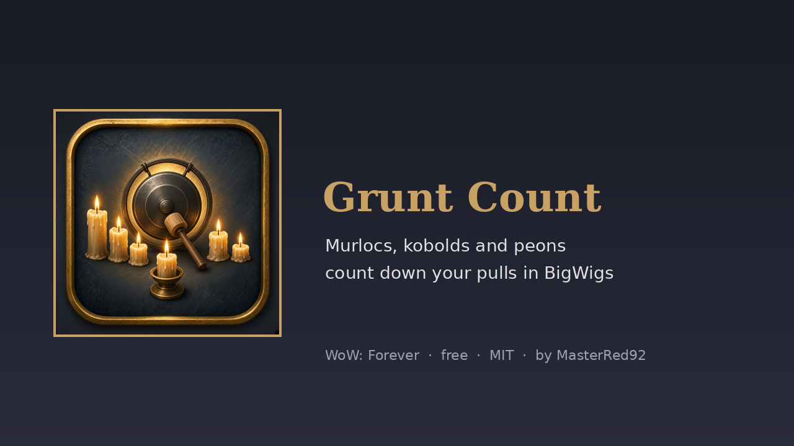
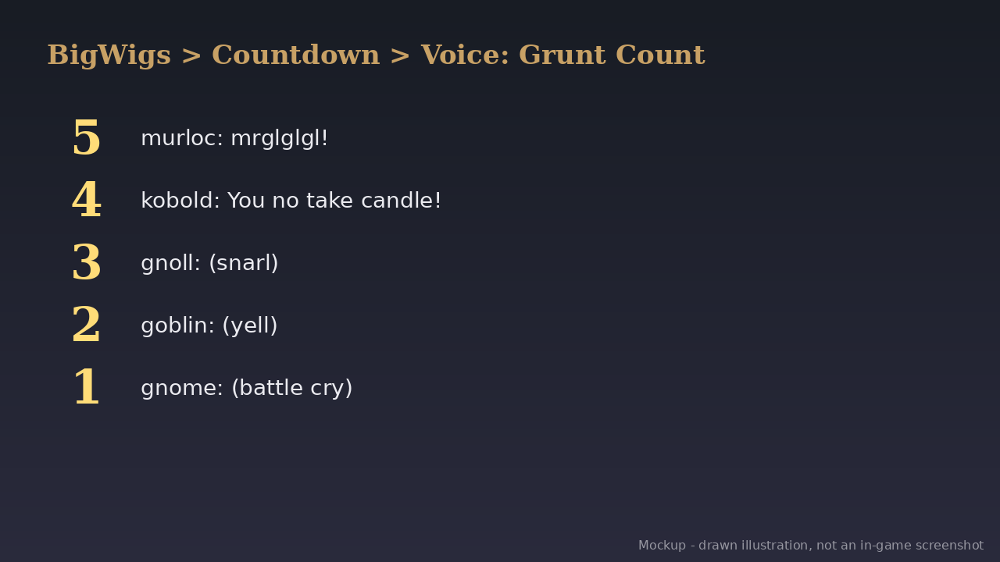

# Grunt Count (WoW: Forever) v1.1.0

   

Vanilla NPCs never learned to count, so they grunt instead. **Grunt Count** adds two countdown voices to BigWigs:

- **Critters:** 5 murloc, 4 kobold ("You no take candle!"), 3 gnoll, 2 goblin, 1 gnome.
- **Work Work:** peons and peasants count you in.

Pick one in BigWigs > Countdown > Voice, and BigWigs uses it wherever it counts down (pulls and boss abilities). Every sound is already in the WoW: Forever client and is played by its sound ID; nothing is bundled. Preview with `/gruntcount critters` or `/gruntcount work` (not in combat).

**Needs:** Required for anything to play: [BigWigs](https://www.curseforge.com/wow/addons/big-wigs).

**Works with:** BigWigs (required). BRBoss, Wipe & Win Lines and Questie: Job's Done wait until a countdown has finished.

## Download
- **Wago Addons:** coming at launch (Nov 4). The link goes here when the project is live.
- **CurseForge:** maybe later.
- **GitHub:** [Releases](https://github.com/masterred92/GruntCount/releases) (from the first tagged release) · [Issues](https://github.com/masterred92/GruntCount/issues)
- **More by Kenny:** [BRBoss](https://github.com/masterred92/BRBoss) · [WipeAndWin](https://github.com/masterred92/WipeAndWin) · [ParchmentBars](https://github.com/masterred92/ParchmentBars) · [all WoW: Forever addons](https://github.com/masterred92/wow-forever-addons)

## Commands
`/gruntcount critters` · `/gruntcount work`

## Install
Put the `GruntCount` folder in `World of Warcraft\_forever_\Interface\AddOns\` and restart the game or `/reload`.

## In-game test checklist (launch day)
1. Listed in AddOns with its icon.
2. `/gruntcount critters` and `/gruntcount work` play five sounds, a second apart.
3. BigWigs > Countdown > Voice lists both 'Grunt Count' voices. Pick one and do a BigWigs `/pull 5`: it counts with grunts.

## Licence
MIT. Written from scratch; no code copied from other addons. Free, no paid features. It doesn't automate gameplay: everything it does is a reaction you can see or something you typed.

## Development
`tests/run.sh [path-to-wow-ui-source-forever]` runs `luac -p`, luacheck, the mock-client tests and (with a path) an API check against Blizzard's Forever UI source and the host addons' source. GitHub Actions runs the tests on every push. The release workflow is a manual dry run that builds the zip with [BigWigsMods/packager](https://github.com/BigWigsMods/packager); publishing is switched off until the Wago project ID is added (see the comments in `.github/workflows/release.yml`).
